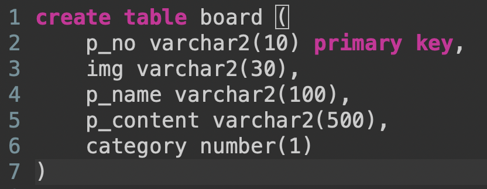
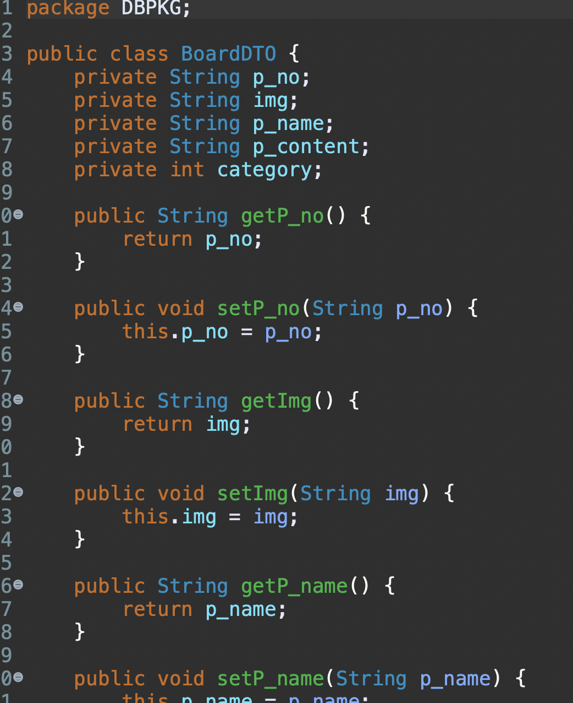
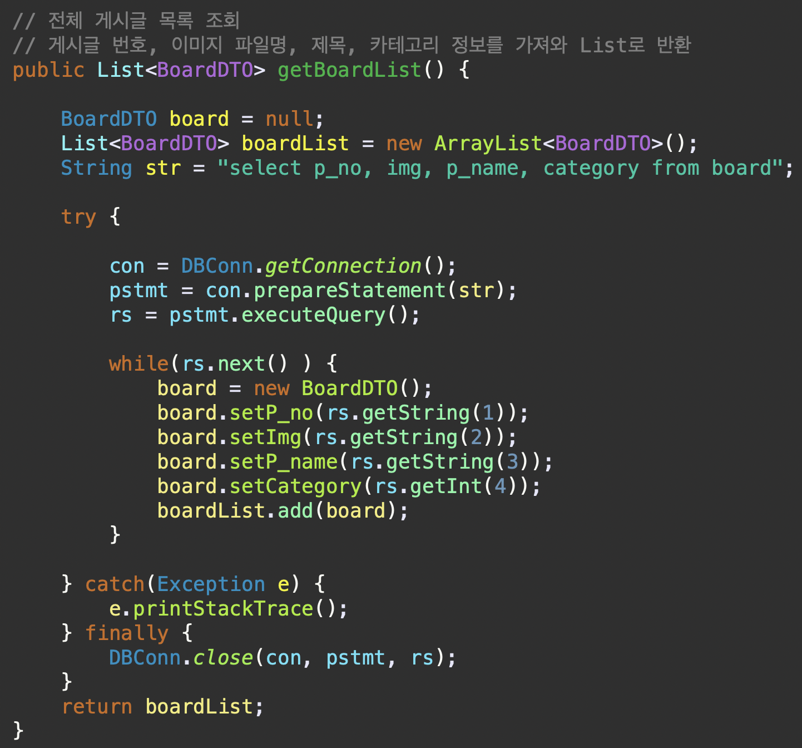
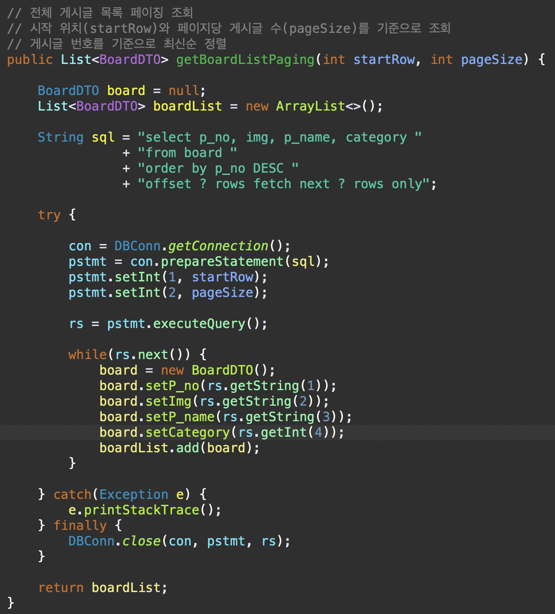
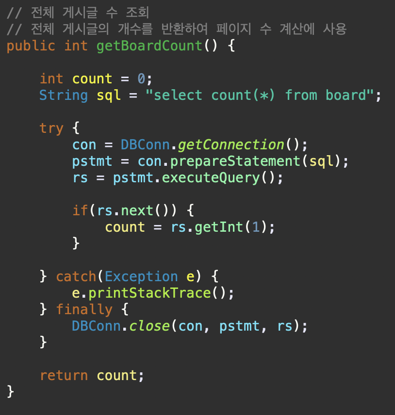
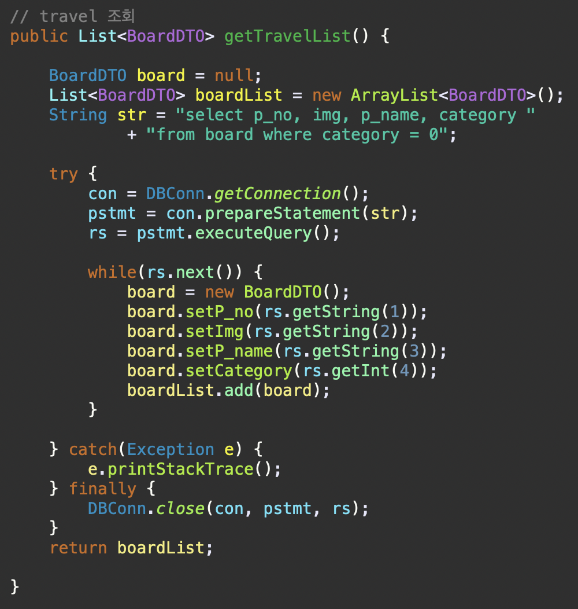
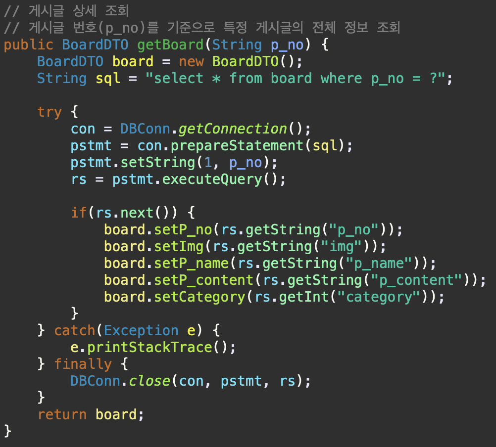

# PhotoBlog

## 1. 프로젝트 소개
개인 사진을 카테고리별로 관리하고 확인할 수 있는 사진 블로그입니다.

## 2. 개발 환경
- Language: Java, JavaScript
- Frontend: JSP, HTML, CSS, Bootstrap
- Backend: JSP, Java
- Database: Oracle DB
- Server: Apache Tomcat
- IDE: Eclipse

## 3. 주요 기능
- 사진 목록 출력
- 카테고리별 사진 분류
- 데이터베이스 연동
- 사진 정보 조회

## 4. 프로젝트 화면

  

## 5. 데이터베이스 구조

  

## 6. 데이터 처리 구조

  <h1>DTO</h1>
  

  <h1>DAO</h1>
  
  
  
  
  

## 7. 개발 중 발생한 문제 및 해결
이미지 파일 확장자 대소문자 문제

문제: 게시글에 등록된 이미지가 웹페이지에서 정상적으로 출력되지 않는 현상 발생

원인: 데이터베이스에 저장된 이미지 파일명과 실제 이미지 파일의 확장자 대소문자가 일치하지 않아 파일을 찾지 못하는 문제 확인

해결: 데이터베이스에 저장된 이미지 파일명과 실제 파일의 확장자를 일치시키고, 이미지 경로를 수정하여 정상적으로 출력되도록 개선

이 과정을 통해 이미지 파일을 데이터베이스와 연동할 때 파일명 및 확장자, 경로의 정확성이 중요하다는 점을 확인했습니다.

## 8. 실행 방법
1. 데이터베이스 실행

Docker Desktop을 실행합니다.

Oracle Database 컨테이너를 시작합니다.

Oracle Database가 정상적으로 실행되었는지 확인합니다.

프로젝트의 DBConn.java에 설정된 데이터베이스 접속 정보를 확인합니다.

*개발환경이 맥OS이었기 때문에 Oracle DB를 사용하기 위해서 Docker를 이용하였습니다.

2. 프로젝트 실행

Eclipse에서 PhotoBlog 프로젝트를 Import합니다.

프로젝트의 Oracle JDBC 드라이버 설정을 확인합니다.

프로젝트를 Tomcat 서버에 추가합니다.

Tomcat 서버를 실행합니다.

웹 브라우저에서 아래 주소로 접속합니다.

http://localhost:8090/PhotoBlog/
