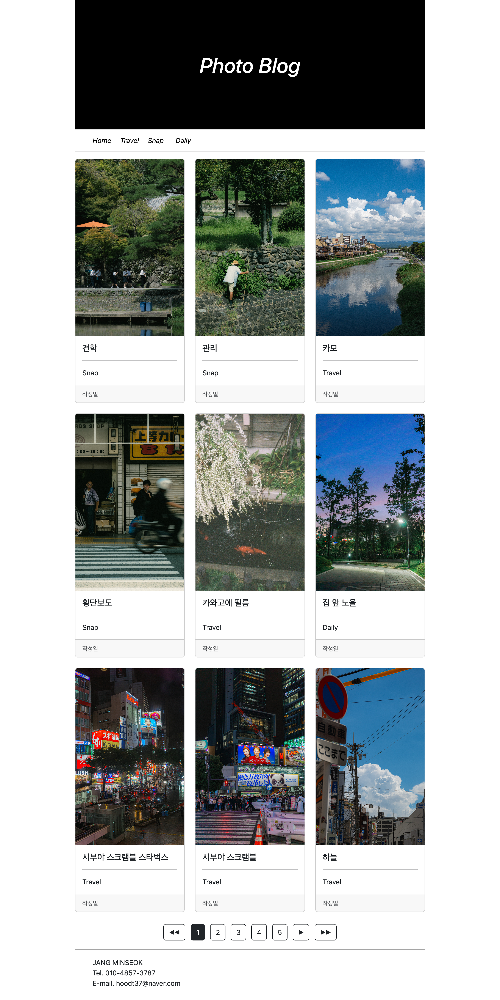

# PhotoBlog

## 1. 프로젝트 소개
개인 사진을 카테고리별로 관리하고 확인할 수 있는 사진 블로그입니다.

## 2. 개발 환경
- Language: Java, JavaScript
- Frontend: JSP, HTML, CSS, Bootstrap
- Backend: JSP, Java
- Database: Oracle DB
- Server: Apache Tomcat
- IDE: Eclipse

## 3. 주요 기능
- 사진 목록 출력
- 카테고리별 사진 분류
- 데이터베이스 연동
- 사진 정보 조회

※ 실제 구현한 기능만 기재

## 4. 프로젝트 화면

  

## 5. 데이터베이스 구조
(테이블 구조 또는 ERD 첨부)

## 6. 데이터 처리 구조
(DAO, DTO를 활용한 데이터 처리 과정 설명)

## 7. 개발 중 발생한 문제 및 해결
(실제 겪었던 오류와 해결 과정 작성)

## 8. 실행 방법
(서버 및 데이터베이스 실행 방법 작성)
